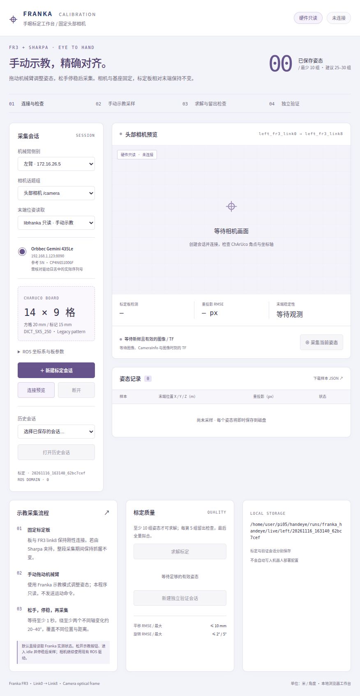

# Franka FR3 + Sharpa 固定头部相机手眼标定

浏览器工作台：**Franka 示教模式手动拖动 → 松手停稳 → 点击采样 → 求解 → 新姿态独立验证**。
程序不控制机械臂或 Sharpa，不回零，不自动进入示教，不改变负载、碰撞阈值或网络。
原 UR 脚本和配置保留；新增 Franka 会话独立保存，不复用 UR 外参。本机历史标定结果不随公开仓库上传。

工控机的完整安装、Docker／本机两种启动方式、手动拖动采样、求解、独立验证及故障排查，见 [工控机完整操作手册](docs/IPC_OPERATION_GUIDE.md)。你提供的遥操工程使用 Docker 内的 ROS Humble 和 libfranka，优先按手册复用现场已有镜像；宿主机安装方案只适用于已具备匹配 ROS／SDK 的环境。



公开仓库包含源码、参考配置、离线测试和部署文档；不包含采样数据、历史标定结果、日志、虚拟环境、编译产物或本机环境文件。真实使用前需按现场硬件核对地址、相机身份和坐标系。

### 本机快捷启动

本机已构建 `franka-handeye:local` 标定镜像，可直接执行：

```bash
cd /home/descfly/LTT/franka-handeye
./start_local_handeye.sh
```

在本机浏览器打开 [http://127.0.0.1:8766](http://127.0.0.1:8766)。本机 8765 已用于数据处理控制台，因此快捷脚本默认使用 8766。
脚本默认复用 `/home/descfly/ZH/gello_upper_body_teleop` 的 Compose／ROS 配置；其他机器可通过 `TELEOP_REPO` 覆盖路径，通过 `HANDEYE_PORT` 覆盖端口。
镜像需预先按下文构建；快捷脚本会编译只读读取器并启动网页服务。
当前三相机部署的头部相机在界面选择 `/cam0`；选择标定臂和“libfranka 只读 · 手动示教”，新建会话后再连接预览。
终端按 Ctrl+C 停止服务。数据保存在本项目的 `runs/franka_handeye/`。

## 1. 已适配的硬件与坐标链

核对来源：用户提供的 [Franka/GELLO/Sharpa 工程](https://github.com/ma39nong/Franka_Gello_Sharpa_armhand_-_-)。

| 项目 | 默认值 | 来源与意义 |
| --- | --- | --- |
| 左 FR3 | `172.16.26.5` | `config/workcell/current.yaml` |
| 右 FR3 | `172.16.26.4` | 同上 |
| 头部 Orbbec Gemini 435Le | `192.168.1.123:8090`，参考序列号 `CP4N651006F` | `docs/ORBBEC_CAMERA.md`，设备曾更换，需核对现场驱动日志 |
| 图像 / 内参 | `/camera/color/image_raw` / `/camera/color/camera_info` | 单头部相机；三相机采集入口选择 `/cam0` |
| 基座 → 法兰 | `left_fr3_link0` → `left_fr3_link8`，右侧同理 | 不使用 `world`、UR `tool0` 或假定的 Sharpa 指尖 TCP |
| 标定板 | 14×9 格 ChArUco，20 mm 格，15 mm 标记，`DICT_5X5_250`，legacy=true | 用户确认沿用现有板 |

板必须刚性安装到所选臂的法兰／手部支架。若由 Sharpa 夹持，整段拟合及独立验证期间板相对法兰不能移动；程序无需 Sharpa SDK、设备序列号或发指令。
头部相机必须相对基座固定；若头部可转动，应固定头部姿态，移动后重新标定。

## 2. 工控机准备（只需首次）

把本目录完整复制到工控机，例如 `/home/descfly/handeye`。
在与 ROS 的 `cv_bridge` ABI 匹配的 Python 环境运行。Ubuntu 24.04 常用 ROS Jazzy / Python 3.12；22.04 常用 Humble / Python 3.10。
已有环境不必重复安装；缺少依赖时可安装：

```bash
sudo apt install python3-opencv python3-numpy python3-scipy cmake g++
```

还需要当前 ROS 发行版的 `rclpy`、`sensor_msgs`、`cv_bridge`、`tf2_ros`。
检查：

```bash
source /opt/ros/jazzy/setup.bash  # Humble 工控机改为 humble
python3 -c 'import cv2,numpy,scipy,rclpy,cv_bridge,tf2_ros; assert hasattr(cv2,"aruco"); print("依赖正常")'
```

默认的手动示教模式使用 **libfranka `Robot::read()`** 直接读取状态，不启动 ros2_control 运动控制器。
使用工控机与机器人系统版本匹配的已有 libfranka 编译只读读取器，不要为本程序升级正在使用的 libfranka：

```bash
cd /home/descfly/handeye
cmake -S native -B native/build-ipc
cmake --build native/build-ipc -j2
export HANDEYE_FRANKA_READER="$PWD/native/build-ipc/franka_state_reader"
```

找不到 `FrankaConfig.cmake` 时，在 cmake 命令后追加 `-DFranka_DIR=/实际路径/lib/cmake/Franka`。
可用 `HANDEYE_FRANKA_READER=/绝对路径/franka_state_reader` 指向已编译读取器。
本地生成的二进制不能代替工控机上的兼容编译。

## 3. 手动示教启动

1. 在 Franka Desk 按现场已有流程准备 FCI 及手动示教。停用该臂的遥操／部署／运动控制会话，释放 FCI 连接；不要为采样启动 GELLO 或关节阻抗控制器。
2. 保持 Sharpa 抓握及负载设置符合现场实际。用机器人自身示教按钮拖动；本程序不设置示教或负载参数。
3. 仅启动已有 Orbbec 相机服务。单相机部署通常在遥操工程的 `docker/` 执行 `docker compose up -d orbbec`；如已有 `/cam0` 三相机服务，沿用它，不启动第二个相机所有者。无需录制 rosbag。
4. 启动本程序。设置 `TELEOP_REPO` 为现场的遥操工程路径（仓库文档示例是 `/home/descfly/llx/gello_upper_body_teleop`，以实际路径为准）：

```bash
cd /home/descfly/handeye
TELEOP_REPO=/home/descfly/llx/gello_upper_body_teleop ./start_franka_handeye.sh
```

启动器只读取 `docker/.env` 的 `TELEOP_ROS_DOMAIN_ID`（若已有 `ROS_DOMAIN_ID` 则优先沿用），source 本机 ROS 及可用的工作区 overlay。
不会执行或覆盖遥操配置。`RMW_IMPLEMENTATION`、`CYCLONEDDS_URI`、`ROS_LOCALHOST_ONLY` 沿用当前 shell；须与相机节点一致，必要时先按现场环境设置。
不传 `TELEOP_REPO` 时沿用当前 ROS 环境及默认 domain=0。
若现场 ROS 在 Pixi／Conda 内，应先激活它并设置 `HANDEYE_PYTHON`，确保与 `cv_bridge` 匹配。

在工控机浏览器打开 [http://127.0.0.1:8765](http://127.0.0.1:8765)。程序只监听 loopback。
可用 `--port 8766` 或 `--output-dir /数据盘/handeye` 修改端口／输出目录。

5. 选择左／右臂、正确相机话题组，保留“libfranka 只读 · 手动示教”，点击“新建标定会话”及“连接预览”。高级 JSON 可以调整 IP、板和话题。
6. 检查识别出的角点与轴，再手动拖动机械臂。**松开示教按钮、机器人进入 idle，停稳至少 1 秒**后，按钮显示可采集再点击。拖动中（guiding）、运动控制中、停机故障、陈旧状态均拒绝采样。
7. 最少采集 10 组姿态即可求解，建议采 25–30 组。覆盖不同位置、距离及至少两个旋转轴（约20–40°）；只平移／只绕单轴会拒绝求解。近重复姿态会拒绝保存。
8. 点击“求解标定”，检查拟合和每第5组留出指标。通过后，在板安装未改变时点击“新建独立验证会话”，再采5组以上（建议10组）新姿态，点击“检验新姿态”。验证使用新会话创建时保存的固定结果副本，不重拟合。
9. 完成一侧后，再把板装到另一侧，创建另一侧新会话；保持相机及两臂基座不动。重新装板、移动相机／基座、改变相机内参都必须用新会话。

默认 libfranka 路径不依赖机械臂 ROS TF。若现场已有能在示教时持续更新的只读 TF，可改选“已有 ROS TF”，订阅图像时刻 `base_frame → tool_frame`，不会回退到最新 TF。
不要为获得 TF 而开启运动控制器。

## 4. 时间配对、质量门槛和结果

libfranka 输入为实测 `O_T_EE` 与 `F_T_EE`，按列主序解析，并计算：

```text
T_base_flange = O_T_EE @ inverse(F_T_EE)
T_base_flange @ T_flange_board = T_base_camera @ T_camera_board
p_base = T_base_camera @ p_camera_optical
```

Franka 状态记录主机接收时刻和机器人单调时间。相机必须配置为同一工控机 system/global 时间（来源工程已设置 host time 同步）。
只在图像时刻被前后状态包围且间隔≤50ms时插值；不外推、不用最新位姿替换历史位姿。
这属于**主机接收时间配对，并非硬件同步**；仍需停稳采样以降低传输延迟影响。
原始 `O_T_EE`、`F_T_EE`、配对区间、机器人模式、图像时间戳保存在样本 `pose_timing` 中。

- 图像≤1s，Franka最新状态≤0.5s；采样有效观测≤0.8s。
- 稳定窗口≥0.5s且至少4帧，帧间断≤250ms；法兰≤1mm/0.5°、视觉板≤5mm/2°。
- 重投影RMSE≤3px；平面姿态明显歧义、交点不足／共线时拒绝。
- 拟合与留出分别要求平移RMSE及最大≤10mm，旋转RMSE≤2°、最大≤5°。
- 独立验证至少5个新姿态。软件残差通过不等于实际TCP接触精度；结果不自动安装到机器人。

```text
runs/franka_handeye/
  live/left/<会话编号>/
    samples.json
    sample_001.png ...
    calibration.json          # 拟合会话
  live/left/<验证会话编号>/
    samples.json
    calibration_reference.json # 创建验证时固定的标定结果
    validation.json
  live/right/...
```

结果保留原求解器的 `T_base_cam0` / `T_cam0_base`，新增通用的 `T_base_camera` / `T_camera_base`。
`parent_frame`、`child_frame`、`tool_frame` 是实际坐标系；平移单位为米。
`quality_pass` 只代表拟合与留出检查；独立验证在对应 `validation.json`。
`deployment_eligible` 始终为 false，表示没有由本程序授权或应用到机器人。
继续采样会使该会话之前的拟合结果失效并移为 `.previous`，需要重新求解。
历史会话可在下拉框恢复；不能通过浏览器删除样本。

## 5. 本机离线验证

浏览器工作台固定为硬件只读，不提供运行模式切换、仿真预览或仿真姿态按钮。
已有仿真数据原样保留在 `runs/franka_handeye/demo/`，不会出现在硬件历史会话列表，也不能通过 API 恢复或用于独立验证。
合成 ChArUco 输入移至 `tests/synthetic_source.py`，只供离线回归测试使用；测试不会连接机械臂或相机硬件。

```bash
python3 -m pytest -q tests/test_franka_handeye.py
# 可选：已 source ROS 的环境中执行合成 ROS 输入测试
python3 -m pytest -q tests/test_ros_input.py
```

本次交付验证范围：本机编译、合成图像数学回归、采样保护、HTTP 同源保护、浏览器流程。
尚未在工控机或实际 FR3/Orbbec 上验证；FCI 版本兼容、现场示教连接状态、相机实际身份及真实误差需实测。

参考：[Franka 状态字段与坐标定义](https://frankarobotics.github.io/libfranka/latest/structfranka_1_1RobotState.html)、
[只读 read/readOnce 官方说明](https://frankarobotics.github.io/docs/doc/libfranka/docs/overview.html)。
